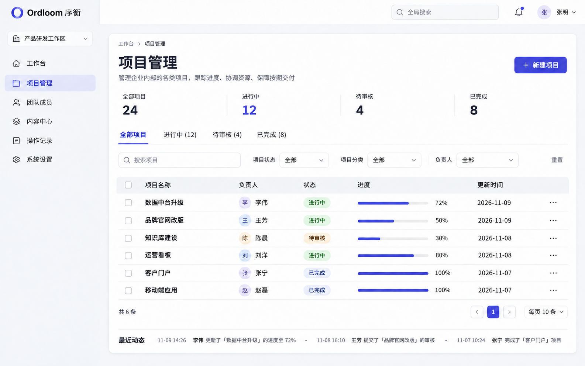
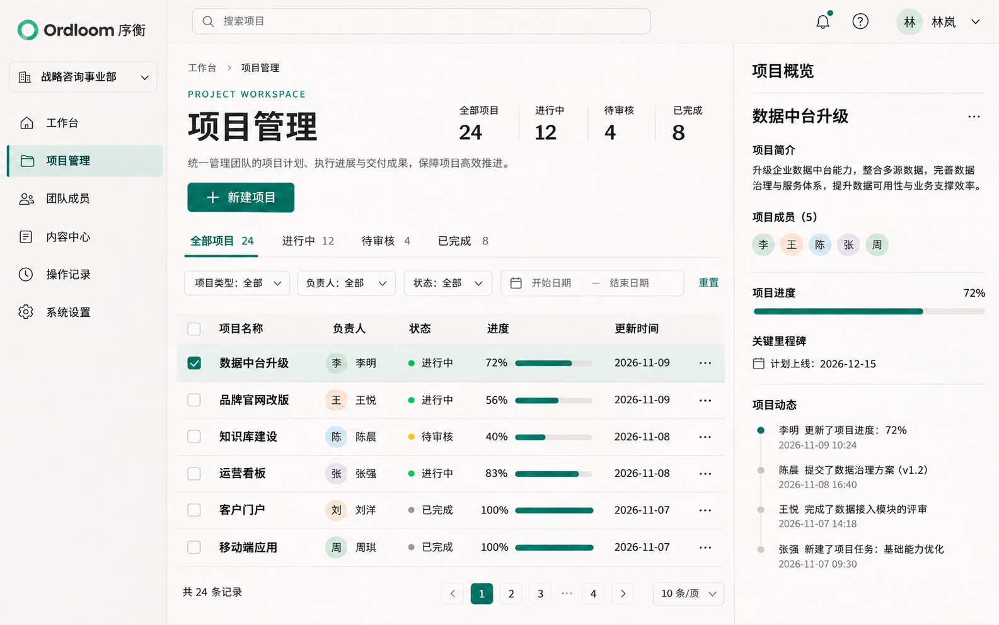
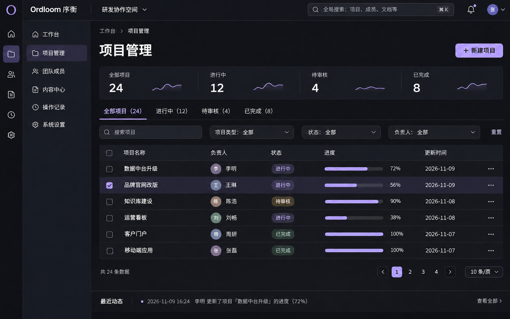

# 设计方向

以下三张图是 **Ordloom 的视觉概念稿**，用于比较品牌和布局方向，不代表 1.0.3 已经交付同样的页面。

## A · 冷白极简

强调清晰的文字层级、留白和克制的主色，适合通用业务后台。

## B · 暖白青瓷

暖白底色与青瓷绿建立品牌识别，列表和详情采用统一栅格，是目前优先讨论的方向。

## C · 深色曜石

以石墨灰、清晰对比和少量浅紫色组织高密度信息，适合研发、运维工作台。

## 配图来源

概念图使用内置 imagegen 工具生成并更新品牌，未使用 CLI/API 回退。品牌编辑提示要求保留各方案的布局、数据和配色，将原有字标替换为 `Ordloom` 与 `序衡`，并改为 O 形标记。

当前手册中的真实组件展示截图位于[组件总览](../components/overview.md)；概念图中的常驻详情栏等布局不应被理解为安装版的功能承诺。
