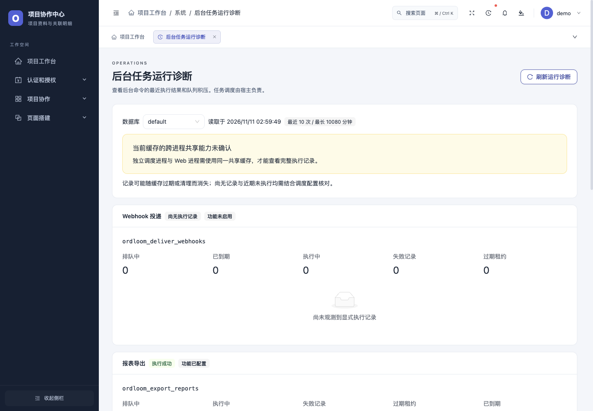

# 界面与交互

Ordloom 的管理界面采用 React 19 和 Ant Design 6。品牌信息与业务站点信息分开配置，支持 8 套主题、明暗模式、导航、密度、字号、圆角和页面宽度。

## 业务工作台

工作台卡片可拖拽排序、调整宽度和隐藏；模型计数与操作趋势读取当前业务权限范围内的数据。
编辑状态、标签页和请求生命周期保持独立，表单保存失败时保留输入并显示具体校验错误。

## 大屏与 H5

以下为合成业务数据的实际页面，图表值经正常查询读取，不保存在画布配置中。

## 运行诊断

诊断页显示有限任务记录与队列计数，支持手动刷新。命令、权限、数据时间及待核对状态在界面中明确展示。

颜色、缩放、触摸、浏览器后台节流与减少动态效果偏好应按实际目标设备核对。具体设置见 [外观指南](../guides/appearance.md)。
