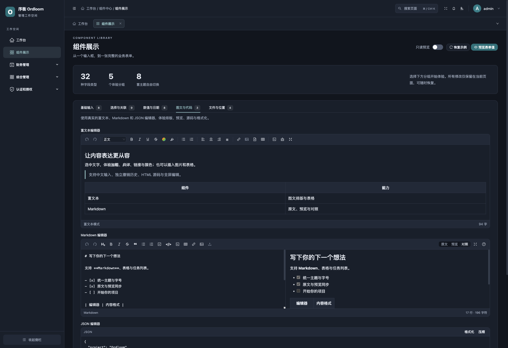

# 32 种字段组件

字段通过元数据中的 `type` 选择前端控件。普通 Django 字段会自动识别，也可以用 `ModelAdmin.simpleui_antd_fields` 调整外观。

| 类型 | 用途 / 来源 | 主要值形态 |
| --- | --- | --- |
| `text` | 文本、CharField | 字符串 |
| `email` | 邮箱 | 字符串 |
| `url` | 链接 | 字符串 |
| `textarea` | 多行文本 | 字符串 |
| `password` | 业务凭据输入 | 新值、空字符串保留、显式 null 清除 |
| `password_status` | UserAdmin 密码状态 | 状态对象，服务端生成 |
| `hidden` | 隐藏表单字段 | 字段原值 |
| `display` | 只读信息 | 字段值或显示内容 |
| `number` | 整数、Decimal / 大整数 | 数字或保留精度的字符串 |
| `select` | 单项选择、外键 | 选项标识 |
| `m2m` | 多对多、多选 | 标识数组 |
| `transfer` | 穿梭选择 | 标识数组 |
| `treeselect` | 组织树单选 | 节点标识 |
| `cascader` | 层级路径 | `/` 分隔路径 |
| `autocomplete` | 候选输入 | 字符串 |
| `checkbox` | CheckboxField | 逗号分隔字符串 |
| `radio` | 单选组 | 选项标识 |
| `bool` | 开关或可空布尔选择 | 布尔值；可空字段可为 null |
| `slider` | 滑块 | 数值 |
| `rate` | 评分 | 数值 |
| `date` | 日期 | `YYYY-MM-DD` |
| `datetime` | 日期与时间 | `YYYY-MM-DD HH:mm:ss` |
| `time` | 时间 | `HH:mm:ss` |
| `color` | 颜色 | `#RRGGBB` 字符串 |
| `image` | 图片 | 上传返回的文件地址 |
| `file` | 文件 | 上传返回的文件地址 |
| `richtext` | HTML 文档 | HTML 字符串 |
| `markdown` | Markdown 文档 | Markdown 原文 |
| `json` | JSON 配置 | 编辑时使用精确文本来源，保存由原生字段解析 |
| `map` | 地图坐标 | `经度,纬度` 字符串 |
| `video` | 视频预览 | 视频 URL |
| `segmented` | 分段选择 | 选项标识 |

`password_status`、`display` 等类型通常由服务端按实际表单生成，不必为它们再增加一个业务模型字段。组件类型也不等同于 Django 字段基类名称。

## 使用组件字段

```python
from django.db import models
from simpleui_antd.components import fields
from simpleui_antd.editor.fields import RichTextField, MDTextField

class Content(models.Model):
    title = models.CharField(max_length=80)
    priority = fields.SliderField(min_value=0, max_value=100, default=50)
    rating = fields.RateField(max_value=5, default=0)
    color = fields.ColorField(default="#4f62d9")
    body = RichTextField(blank=True)
    notes = MDTextField(blank=True)
```

评分、滑块等字段仍是原生数值存储。模型迁移、数据库约束和项目校验不会因为换了控件而消失。

## 常用外观参数

| 配置 | 含义 |
| --- | --- |
| `type` | 内置或自定义组件类型 |
| `placeholder` | 输入提示 |
| `rows` | 文本或编辑器初始高度 |
| `span` | 表单宽度，通常为 1 或 2 |
| `min` / `max` / `step` / `precision` | 数值界面选项 |
| `accept` / `max_upload_size_mb` | 上传格式与大小 |
| `titles` / `filterable` | 穿梭选择标题及搜索 |
| `tile_url` / `tile_attribution` | 地图底图配置 |

控件禁用只影响交互时，应同步考虑原生表单和服务端权限配置。

## 体验编辑器



图片是当前开发源码中的演示界面；安装版的品牌文字以[版本说明](../reference/compatibility.md)为准。
