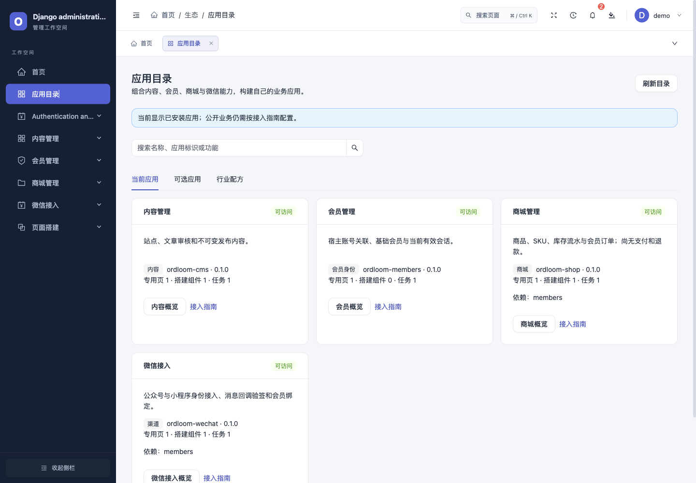

# 生态开放：应用目录、兼容检查与行业配方

Ordloom 1.1.0 提供 SDK v1、应用目录、兼容验收与行业配方；CMS、会员、商城、微信各以 0.1.0 独立安装，要求核心 1.1.0+。生态声明与测试协议不新增业务模型，核心升级另含页面版本及告警相关 0028/0029/0030。现有页面、会员和业务接口继续沿用原协议。

## 应用目录

后台「应用目录」提供三个视图：

| 视图 | 用途 | 权限范围 |
| --- | --- | --- |
| 当前应用 | 版本、依赖、用途、当前可用的页面/组件/任务数量及页面入口 | 有效 staff 只看通过现有权限的应用；超级管理员额外查看已安装但停用的声明 |
| 可选应用 | CMS、会员、商城和微信的发行包参考目录与接入指南 | 固定的本地介绍，不表示这些应用已经安装 |
| 行业配方 | 必选/可选组合、业务步骤、当前边界 | “可访问”依据当前账号的可用应用判断，不代表真实环境已经验收 |

`GET /api/extensions/directory/` 返回只读目录；挂载于 `/admin/` 时路径相应增加前缀。请求重新验证 staff、Django 权限和 ModelAdmin 模块/查看权限，禁止 POST。普通员工看不到无权应用的安装状态、版本和计数；配方只提示需要接入或授权。目录不读取业务记录、凭据或组件默认内容，也不提供远程安装、启停、业务写入或执行任务的入口。

目录每 15 秒在当前可见页面重读，切换/隐藏时取消，拒绝或失败会清除旧目录；恢复后重新鉴权。公开渲染继续使用原 `/api/extensions/public/`，不新增匿名安装信息接口。

本地隔离工程中的应用目录（演示数据）：



## 第三方清单

原清单保持兼容，新字段均可选。为便于发现与发布，第三方建议完整填写说明和分发包名：

```python
from ordloom.sdk import Application

application = Application(
    id="booking",
    label="预约服务",
    version="0.1.0",
    asset="ordloom_booking/extension.js",
    description="服务项目、时段与会员预约。",
    category="industry",
    distribution="ordloom-booking",
    documentation_url="https://example.org/booking/docs/",
    requires=("members",),
    requires_versions={"members": ">=0.1.0,<0.2.0"},
)
```

此处只是清单示意，不表示预约子应用已经实现。category 可选 general、content、identity、commerce、channel、operations、industry；documentation_url 只接受无用户名/密码的 HTTPS URL。distribution 为本地分发包名元数据，不用于动态导入或在线安装。

`requires_versions` 仅允许对 `requires` 中的应用 ID 声明限制，支持 `>=`、`>`、`==`、`<=`、`<` 与最多四个逗号分隔条件，版本限 `x.y.z`。当前声明版本与宿主范围检查仍保留；依赖版本不匹配使 `ordloom.E080` 失败。安装包依赖仍须写入 pyproject，由 pip/uv 在部署时解析；清单约束不能代替安装依赖。显式停用某个应用会连带停用其传递依赖者，避免影响无关应用；未安装的缺失依赖仍是配置错误。

通常 AppConfig 的固定 `ordloom_application` 就足够。若应用像微信一样按配置动态返回 None，可另外声明固定的 `ordloom_catalog_application` 指向同一清单，使超级管理员和显式检查能读取停用应用的静态描述；它不会启用菜单、组件或任务，也不会绕过模块开关。

## 本地兼容门禁与升级基线

```bash
# 在宿主中检查当前有效声明，保存首次通过的基线和报告
python manage.py ordloom_check_apps --json --snapshot /tmp/apps-baseline.json --output /tmp/apps-report.json
# 安装新版本后，与同一组应用的旧基线比较
python manage.py ordloom_check_apps --json --baseline /tmp/apps-baseline.json --output /tmp/apps-upgrade.json
# 部署前明确检查已安装但停用的声明
python manage.py ordloom_check_apps --include-disabled --json
```

这些命令在完成 Django 启动后不访问业务数据库、不调用页面/任务处理器、不修改设置。输出路径须是新文件，父目录需存在；失败退出非零，JSON 报告保留安全错误类型，不输出异常详情。基线限本地 2 MB JSON，拒绝重复键、未知协议与畸形结构。应用目录不提供命令执行 API。

声明检查覆盖 SDK/宿主版本、依赖与依赖版本、资源路径、属性 schema、权限是否在模型元数据中声明，以及关联 ModelAdmin 是否注册。没有使用超级管理员能绕过的“任意权限字符串”作为认证依据。

升级比较会阻断以下变化，要求开发者复核迁移与运行时行为：

- 删除应用、页面、组件或任务；版本回退。
- 改变宿主/依赖范围、权限集合或模型范围。
- 改变组件公开策略或已有组件的字段 schema。采用保守复核，新增可选字段也要求检查已保存配置。

版本正常递增、新增扩展点不会单独失败。前端资源哈希变化会单独列出 `changed_assets`，仍须运行运行时测试。通过声明比较不证明 Python/JavaScript 行为相同；通过复核后，使用新文件保存新的基线并保留旧记录。

报告记录规范化契约 SHA256、应用版本和前端资源 SHA256。范围为 `static_declaration_contract`，`runtime_tests` 明确为 `not_executed`；本地报告不带官方签名，不属于安全审计或发行方背书。它不会证明第三方包安全，也不代替组织/租户、字段权限、业务操作和迁移的专项测试。

## 第三方开发与独立安装验收

```bash
python manage.py ordloom_startapp news /tmp/ordloom-news --label 新闻中心
pip install -e /tmp/ordloom-news
DJANGO_SETTINGS_MODULE=ordloom_news.test_settings python -m django test ordloom_news
```

脚手架及独立示例带可运行的测试宿主和 7 项契约测试，包含专用页/资源、禁止访问、公开目录、对象范围/撤权、停用拒绝、实际保存接口与任务租约/重复执行。公开工具 `ordloom.testing.SubApplicationContractMixin` 提供通用 GET 契约；测试类需提供 app_id、authorized_client、forbidden_client、anonymous_client。如宿主使用后台命名空间，可设 sdk_namespace；默认读取隔离工具传入的命名空间。自定义用户工厂及额外必填字段需按实际工程调整 fixture。

应用自己的测试仍要按真实业务覆盖写入、动态字段、任务幂等、租约重入、共享缓存故障和历史数据升级，不能把示例断言当作其他应用的证明。`application_contract` 可记录通过断言后的分类覆盖，未报告项为 `not_reported`。通用工具不会主动运行业务任务；只有测试/升级 fixture 显式调用的任务才执行。开发代码、构建脚本和前端入口都是可信安装代码，SDK 没有第三方代码沙箱。

仓库开发工具可从受信任的本地包构建 wheel/sdist，分别在新虚拟环境中安装核心与组合包，运行真实测试、声明门禁、迁移漂移与静态收集检查：

```bash
# 在 Ordloom 仓库，使用已装 build、Django、uv、Node 的开发环境
npm ci --prefix frontend
python scripts/test_subapplication.py --package /tmp/ordloom-news --app-config ordloom_news.apps.ExtensionConfig --output /tmp/news-compat.json
# 带另一个受信任的独立应用组合安装
python scripts/test_subapplication.py --package /tmp/ordloom-news --app-config ordloom_news.apps.ExtensionConfig --peer examples/ordloom-demo --peer-config ordloom_demo.apps.ExtensionConfig --output /tmp/news-composition.json
```

可重复 `--peer`、`--peer-config`、`--test-label`，用 `--python` 指定解释器、`--django 4.2|5.2|6.0` 指定系列。默认 Python 3.9 配 4.2，其余配 5.2；选择的解释器须支持对应 Django。`--baseline` 接受先前导出的同组合契约 JSON，只做声明比较，不代表有数据升级。工具不读取既有宿主设置/数据库；各应用需提供能在隔离测试宿主运行的测试，自定义业务 URL 可在应用测试中 override_settings(ROOT_URLCONF=...)。每个组合应用都须有非全跳过的运行测试及必要 SDK 访问断言，`--test-label` 不能遗漏 peer。

每个应用必须声明 distribution 且与安装包版本一致。工具强制检查实际分发 ESM 的语法、activate/注册和宿主 React/Ant Design 下的渲染；页面数据来自已通过授权断言的真实 API。报告绑定 wheel/sdist 与入口哈希，分别列出声明、逐应用覆盖、前端和数据升级结果；jsdom 不替代原生浏览器或真机。

真实升级使用 `--previous-package`、逐 peer 的 `--previous-peer` 和固定 `ordloom_upgrade_fixture`：旧包创建合成业务记录，新包迁移同一专有 SQLite 数据库，验证旧业务数据、已保存组件、用户权限/组和对象范围；可通过 `--context-app`、`--user-model`、`--namespace` 验证自定义 User/后台命名空间。完整协议、侧载 fixture、示例和正反例命令见 [P1 运行与升级验收](../guides/p1-admission-and-contracts.md)。真实外部平台、数据规模与生产部署仍需单独验收。此工具随仓库提供，未作为后台在线执行能力开放。

## 行业配方与独立工程

| 配方 ID | 必选应用 | 可选应用 | 已有闭环 |
| --- | --- | --- | --- |
| content_site | cms | members | 文章编辑、审核发布与公开内容访问 |
| member_portal | cms、members | wechat | 会员专享内容与当前身份校验 |
| campaign | cms、members、wechat | 无 | 内容/H5 表单与微信会员入口；身份不自动关联匿名答卷 |
| brand_shop | members、shop | cms、wechat | 商品、库存、会员下单与人工履约；尚无支付退款 |

在已安装并注册相应应用的宿主中运行，生成到新的独立目录：

```bash
python manage.py ordloom_startsolution content_site /tmp/company-site
python manage.py ordloom_startsolution brand_shop /tmp/brand-shop --with-app cms --with-app wechat
```

生成 manage.py、settings/urls/wsgi、README、框架 requirements 与配方版本清单。依赖按声明顺序展开，使用已安装的 AppConfig，不从用户输入导入模块；只接受配方声明的可选应用。生成期间不连接数据库、不安装软件、不复制业务数据、不修改当前工程，不覆盖已有目录。

新工程从环境变量读取 `DJANGO_SECRET_KEY`，注册/商城公开/下单/微信默认关闭。按生成 README 执行 `pip install -r requirements.txt`、配置密钥后执行 check/migrate/createsuperuser。requirements 包含核心兼容范围和已声明分发包的应用固定版本；未声明分发包名的第三方应用按其指南另行安装。内置应用有已知 URL 挂载；第三方业务 URL 仍需在新工程显式 include。数据库、生产 ASGI/HTTPS、组织权限、共享缓存、静态/媒体和任务调度由宿主配置。

宿主可扩展纯声明配方，不能写执行代码或导入路径：

```python
ORDLOOM_APP_RECIPES = [
    {
        "id": "my_portal",
        "label": "客户内容门户",
        "description": "以内容与会员组成客户自助入口。",
        "applications": ["cms", "members"],
        "optional": ["wechat"],
        "steps": ["设置站点和会员访问策略。", "配置员工和对象范围后验证公开页面。"],
        "limits": "不包含支付与第三方消息外发。",
    }
]
```

内置与自定义配方合计最多 32 项，标识唯一，必选与可选不重叠。纯本地配方不连接远端应用市场；新增行业模型应继续开发成独立子应用。
