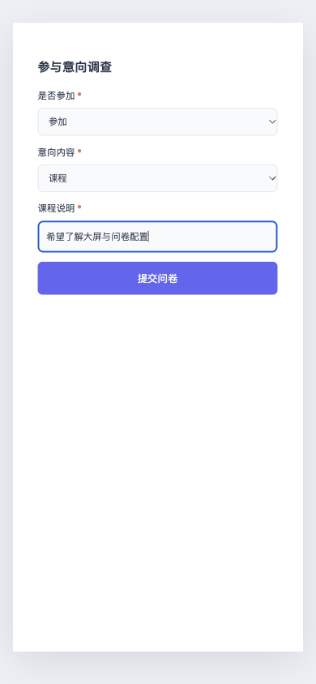
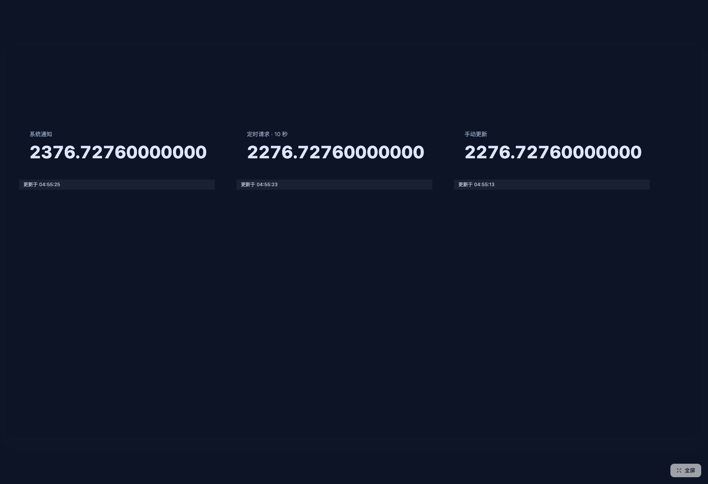
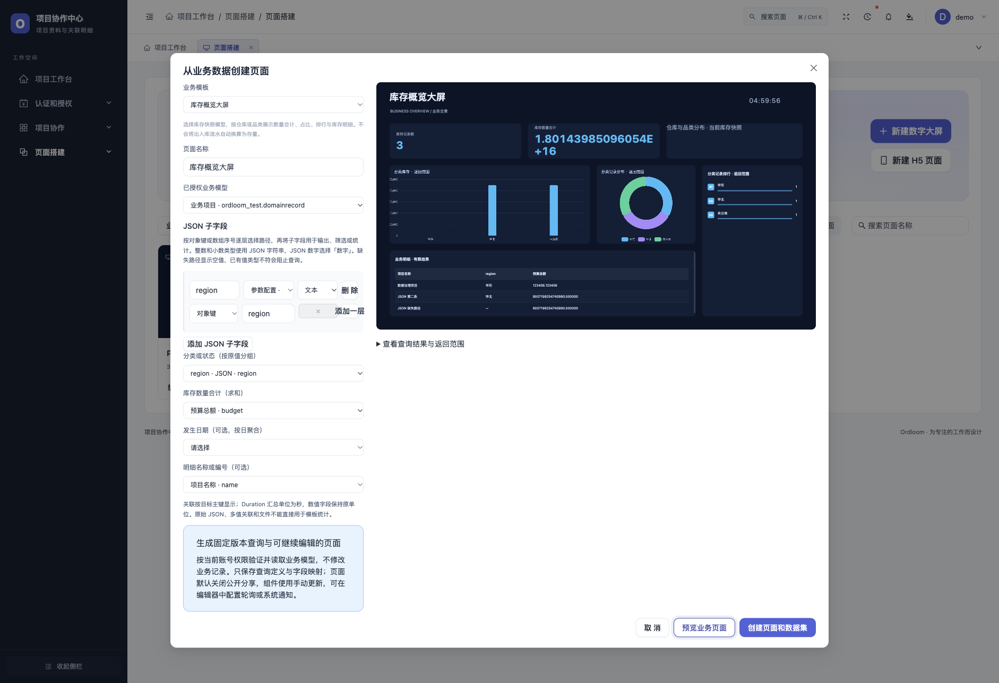
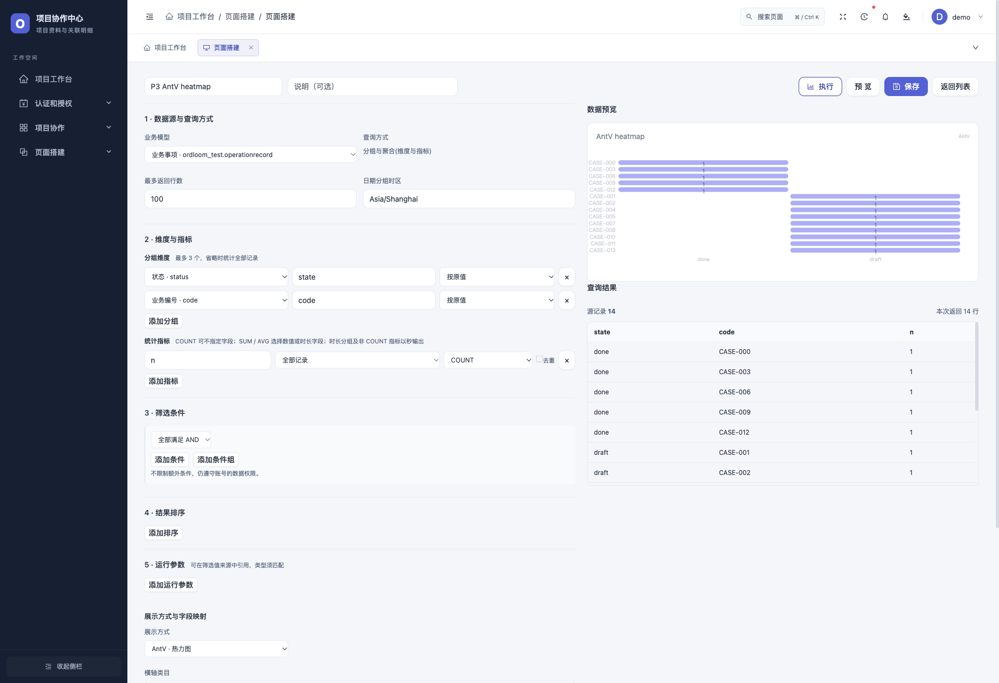

# Ordloom 1.0.1：条件问卷、公开通知与行业报表

1.0.1 完成路线图 P2 与本批 P3：问卷条件显示和向后跳题、按页面授权的公开变更通知、三套行业业务模板、模板字段适配及七类 AntV 报表。同时包含运维预检、任务主动告警和答卷后台导出等 P1 功能。

```bash
pip install --upgrade ordloom==1.0.1
# 需要数据集、业务模板和自助报表时
pip install --upgrade 'ordloom[graphql]==1.0.1'
python manage.py migrate
python manage.py collectstatic --noinput
```

核心支持 Python 3.9+、Django 4.2+；GraphQL 扩展需要 Python 3.10+、Django 5.2+。本批 P2/P3 无新迁移，P1 的 0027 迁移需要执行。现有页面、题目、发布版本、报表和更新策略继续可用；新功能不改变默认资源权限。

## 条件问卷

在表单组件的题目编辑器中设置「显示条件」。每题可使用前面题目的 1–5 个条件，选择全部满足或任一满足。支持等于、不等于、多选包含、已填写、未填写；选择题比较值来自已有选项，评分比较值为 1–5。

单选题和下拉题还可按选项跳到后续题目，或跳到结束后由用户提交。显示条件只能引用前题，跳题只能前进，配置不能形成循环。移动、删除题目或改动选项后，编辑器提示失效规则；修正后才能保存。配置中引用稳定的题目 ID，不依赖显示序号。



例如，选择「课程」才显示必填的课程说明，选择「退出」跳到结束：

```json
[
  {"id":"kind","type":"select","label":"是否参加","required":true,
   "options":["参加","退出"],"jumps":[{"value":"退出","target":"$end"}]},
  {"id":"topic","type":"select","label":"意向内容","required":true,"options":["活动","课程"]},
  {"id":"detail","type":"text","label":"课程说明","required":true,
   "showWhen":{"match":"all","conditions":[{"field":"topic","operator":"eq","value":"课程"}]}}
]
```

前后端按同一顺序判定实际显示的题目。隐藏和跳过的题目不校验必填，提交时丢弃它们的答案；从可见变为隐藏时，浏览器清除原答案。隐藏来源题的旧值也不能激活后题，即使条件为「不等于」或「未填写」。文本条件按去除首尾空白后的文本比较，不隐式进行数字、日期或时区转换。

答卷保存提交时的题目和规则快照，后续编辑不改变历史答卷。结果详情、同步 CSV/Excel、后台导出及汇总只计入当时实际显示的题目；隐藏题不计入「未填」。旧的无规则问卷仍按原有顺序处理。外部 POST 模式使用相同前端显示规则，目标服务须自行完成可信校验。

## 公开页面通知



在组件的数据绑定中选择系统通知或通知结合轮询，保存页面，再由管理者确认公开数据授权。此能力仅用于有明确授权的数据集绑定；公开页不执行私有报表，也不能订阅任意业务模型。

启用需要可选 GraphQL、事件总线、Channels ASGI 路由和共享缓存。多实例须配置同一个 Redis/Memcached 缓存，以及跨进程 Channels layer，例如：

```bash
pip install channels channels-redis daphne
```

```python
import os

INSTALLED_APPS = ["daphne", *INSTALLED_APPS]
ASGI_APPLICATION = "ordloom.asgi.application"
ORDLOOM_GRAPHQL = {
    "enabled": True,
    "models": {"orders.order": {"fields": ["id", "status", "amount"]}},
}
ORDLOOM_EVENTS = {"enabled": True}
ORDLOOM_PUBLIC_EVENTS = {"enabled": True}
CACHES = {
    "default": {
        "BACKEND": "django.core.cache.backends.redis.RedisCache",
        "LOCATION": os.environ["ORDLOOM_CACHE_URL"],
        "KEY_PREFIX": "ordloom-production",
    }
}
CHANNEL_LAYERS = {
    "default": {
        "BACKEND": "channels_redis.core.RedisChannelLayer",
        "CONFIG": {"hosts": [os.environ["ORDLOOM_CHANNEL_URL"]]},
    }
}
```

示例模型应替换为宿主实际注册且已开放的模型；数据库驱动、Redis Python 客户端与部署服务由宿主安装和运行。自定义 ASGI 工程也可组合 `ordloom.routing.websocket_router`。挂载前缀会自动用于票据 API 和 `/ws/public-page-events/`。

代理必须支持 WebSocket，并让 HTTP 和 ASGI 请求获得一致、可信的 Host、协议与客户端地址。连接只接受与 Host、协议一致的 Origin，不接受查询串凭据；不读取任意转发头猜测来源 IP。部署后运行 `python manage.py ordloom_check --probe --json` 并验证跨实例传播。

| 设置 | 默认值 | 范围或含义 |
| --- | --- | --- |
| `enabled` | `False` | 必须显式开启 |
| `ticket_seconds` | 60 | 15–120 秒，一次性票据有效期 |
| `connection_seconds` | 300 | 60–3600 秒，到期后重新领取票据 |
| `heartbeat_seconds` | 15 | 5–60 秒，复核授权与缓存序号 |
| `tickets_per_minute` | 30 | 1–300，同来源票据及握手各自预算 |
| `messages_per_minute` | 60 | 1–300，同来源客户端帧预算 |

分享内容只有在相关运行时已配置时才增加 `dataGrant.events: true`。这是配置能力声明，不证明代理或 Redis 网络已连通；原有模型目录 `supportsPush` 仍只描述后台入口能力，外部只读服务仍为 false。

浏览器向 `POST /api/share/<uuid>/events/` 提交授权 token、组件 ID 列表和必要的密码，通过既有独立链接 Header 和 CSRF 校验领取票据。响应不包含模型、字段或业务数据。票据绑定可信来源地址和 Host，一次性消费写入共享缓存，不能跨实例重放。WebSocket 在首帧中发送 `{"type":"authenticate","ticket":"..."}`，不把票据、密码或 token 放入连接 URL。握手后 5 秒未认证即断开。

一页支持最多 200 个已授权组件；相同数据集版本与参数合并复核，最多 20 个不同查询。服务端仅发送 `ready`、`pong`、`revoked` 或 `{"type":"changed","widgets":["组件ID"]}`。变化帧最多每秒一次并合并尾部更新，心跳比对共享缓存序号补偿丢失的广播。它是源数据失效通知，可能包含未影响最终筛选结果的变更；不是逐字段值推送。

每次变化通知前和每个心跳都复核页面、授权、确认者、发布版本与现有模型/对象/字段/租户权限。业务重读继续经过原有公开授权端点，只返回绑定映射字段。正常 ORM 写入在事务提交后递增事件序号，公开结果缓存包含该序号，避免通知后重读到旧缓存。批量更新、原始 SQL 或外部系统直写不会自动产生 ORM 信号；宿主可在可信事务提交后显式调用：

```python
from django.db import transaction
from ordloom.graphql.events import record_change

transaction.on_commit(lambda: record_change("orders.order"))
```

撤销授权、轮换 token/分享链接、关闭分享、修改密码/有效期/页面配置或确认者失去权限后，旧订阅不再转发变化；无新事件时最多等待一个心跳发现，并清除浏览器中绑定结果。不能撤回已下载或已显示过的数据。连接达到正常时限时允许重新领取票据；网络失败退避重连，页面隐藏时断开并暂停请求，返回后重新鉴权。

没有连接或通知未配置时，系统通知组件使用已配置间隔或 30 秒兜底；组合策略保留自己的轮询间隔。手动和定时组件的策略相互独立，连接状态变化不会额外刷新手动组件。权限失效停止显示数据。

## 行业业务模板与字段



截图为隔离宿主的合成字段，用于展示映射流程；业务接入须选择实际库存快照模型。

业务模板从 3 套增加至 6 套，与 11 套静态起始模板合计 17 套；组件数量保持 39 种搭建选项、22 类组件。

| 新模板 | 必选字段 | 结果 |
| --- | --- | --- |
| 库存概览大屏 | 分类、库存数量 | 记录数、数量合计、分类贡献、分布、排行与明细 |
| 项目工时大屏 | 项目/人员分类、工时 | 记录数、工时合计、分类投入、排行与明细 |
| 线索跟进简报 | 渠道/阶段分类 | 手机端数量、分布、可选每日趋势与明细，无需金额 |

库存模板要求输入库存快照模型，不自动将出入库流水换算为库存。库存和项目工时模板只统计已填写数值的记录，生成的筛选中明确排除空值；不把未知量当作零。数值字段保持原单位；Duration 字段汇总为秒，并在指标标题标明「秒」。按日趋势是所选日期字段的记录/数值分组，不自动补齐未返回的日期。

模板向导支持显式声明 JSON 子字段并指定路径、名称和标量类型，再将其用于分类、数值和明细；源 JSON 字段权限完整继承。单值关联按目标主键分类/显示，复用关联目标权限；不自动返回关联名称。Duration 可用于求和，旧的原始时长明细表示保持兼容。

`POST /api/data-templates/preview/` 与创建端点增加可选 `jsonFields`，`ordloom_init --recipe` 的业务配方同样支持该声明。预览不落库；创建在事务中生成 3–4 个不可变 v1 数据集及绑定页面，不写业务记录、结果或公开授权，默认关闭分享。原有零售、工单和移动经营模板继续可用。

原始 JSON、多值关联和文件不直接参与模板筛选聚合。多值关联仍须另行设计双方权限、去重和聚合语义；本版不开放任意关联路径或在线代码执行。

## AntV 自助报表

报表新增桑基图、矩形树图、圆打包图、层级树图、关系网络、热力图和环形条图，与大数字、11 类 ECharts 和表格合计 20 种展示方式。选择已授权模型、维度和指标，再按图形角色配置映射、预览并保存。



| 类型 | `chart.type` | `chart.mapping` |
| --- | --- | --- |
| 桑基图/关系网络 | `antv:sankey` / `antv:network` | `source`、`target`、`value` |
| 矩形树/圆打包/层级树 | `antv:treemap` / `antv:pack` / `antv:tree` | `levels`（1–3 个不重复维度）、`value` |
| 热力图 | `antv:heatmap` | `x`、`y`、`value` |
| 环形条图 | `antv:radial` | `label`、`value` |

类目和层级只能选择当前报表维度，数值只能选择数值型指标；配置上限仍为 8 KiB。不接收任意 G2 options、JavaScript 或外部执行地址。例如：

```json
{"type":"antv:heatmap","title":"渠道与阶段分布","mapping":{
  "x":"dimensions.channel","y":"dimensions.stage","value":"metrics.count"
}}
```

查询、预览、保存、工作台/大屏/H5/看板嵌入、刷新、定时导出及主动确认的离线快照复用既有权限链。离线采集只保留实际映射列；公开分享仍隐藏私有报表。CSV/Excel 导出保留原始聚合列和精确数值，不导出像素图。

图形渲染复用已有 AntV 数据校验：层级/流向等图需要适合图形的正数及有效结构，越界数值或非法结构明确报错；不会用示例值填充。大整数/高精度结果建议用大数字、表格或 CSV/Excel 阅读，图形需要转换为 JavaScript 数字。

## 验证与部署

专项覆盖条件/跳题一致性、隐藏答案、历史汇总与导出、一次性票据竞态、同源与凭据边界、授权撤销、缓存刷新、JSON/关联/时长模板和 AntV 映射。可使用隔离命令重跑：

```bash
python scripts/test_backend.py
python scripts/test_ownership_postgres.py --p2-p3
python scripts/test_public_events_cache.py
cd frontend
node --test tests/*.test.js
npm run test:collaboration-ui
```

PostgreSQL/Redis 脚本使用独占的临时 Docker 容器，所需依赖和启动方式见各脚本文件头。真实代理、宿主组织和数据权限、跨机传播、目标设备及负载需在实际部署验收。P1 配置与调度见 [运维与答卷指南](operations-and-submission-exports.md)。
