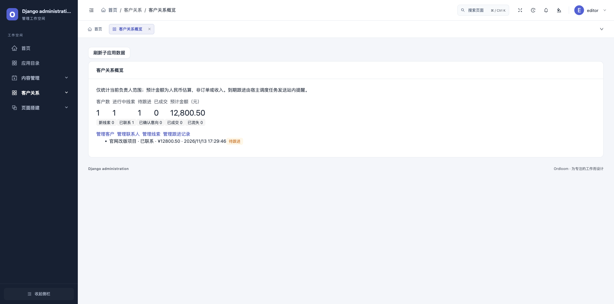

# CRM 客户关系子应用

`ordloom-crm` 0.1.0 是内部员工使用的客户关系 MVP，要求 Python 3.9+、Django 4.2+ 与 `ordloom>=1.1.0,<2`，不依赖会员、商城或其他业务子应用。Ordloom 1.2.0 的应用目录包含其接入信息。

隔离示例中的客户概览（合成业务数据）：



## 安装与权限

```bash
python -m pip install ordloom==1.2.0 ordloom-crm==0.1.0
```

```python
INSTALLED_APPS += ['ordloom_crm.apps.ExtensionConfig']
```

```bash
python manage.py migrate
python manage.py collectstatic --noinput
python manage.py check
```

CRM 没有公开 URL，不需要额外 include。为有效员工授予所需模型的 `view/add/change/delete` 权限，菜单出现「客户关系 → 客户关系概览」；概览和任务同时要求 `ordloom_crm.view_customer`、`ordloom_crm.view_lead`。客户、联系人、线索和跟进记录继续通过 Ordloom 模型管理界面编辑，不引入另一套业务写入 API。

| 模型 | 首版能力 | 权限范围 |
| --- | --- | --- |
| 客户 `customer` | 名称、潜在/合作中/停用状态、行业、来源、负责人、备注 | 普通员工只管理自己负责的客户，创建时负责人为本人；超级管理员可分配和转交给有效员工 |
| 联系人 `contact` | 客户、姓名、职位、邮箱、电话、备注 | 随客户负责人隔离；关联选择与提交校验拒绝其他负责人的客户 |
| 线索 `lead` | 客户、名称、来源、阶段、预计金额、下次跟进时间、流失原因 | 随客户负责人隔离，不能通过伪造关联跨范围写入 |
| 跟进 `followup` | 客户、可选线索、电话/会面/邮件/备注、内容、记录人、时间 | 服务端记录当前员工，只追加；后台与核心 API 不提供修改或删除 |

客户转交会同步改变其联系人、线索和跟进记录的可见范围，历史记录人保留。跟进关联的线索必须属于同一客户；已有跟进的线索不能移到另一个客户。带线索或跟进的客户受外键保护，需保留业务记录。联系邮箱和电话仅供业务登记，不表示经过身份验证。

## 线索和跟进流程

1. 创建客户并记录联系人，再为该客户建立线索；线索从「新线索」开始。
2. 按「新线索 → 已联系 → 已确认意向 → 已成交」推进；任一进行中阶段可转为「已流失」，必须填写流失原因。
3. 禁止跳过阶段或重新打开已成交/已流失线索。结束时自动清除下次跟进时间。
4. 在跟进记录中选择客户和可选线索，记录本次沟通；需要再次提醒时，在对应线索设置新的下次跟进时间。新增跟进记录不会自动更改线索阶段或时间。

预计金额使用两位小数 Decimal 与非负数据库约束，以 CNY 元计；概览按精确小数汇总，并以字符串传输，不代表已收款或会计收入。概览只展示当前权限范围内的客户数、阶段分布、进行中预计金额及最多 20 条待办线索，不返回联系人电话、邮箱或完整跟进内容。宿主隐藏概览依赖字段时，读取会拒绝，不回退为绕过字段权限的查询。

## 到期跟进提醒

宿主 cron 或任务平台显式调度：

```bash
# 默认预览，不生成消息
python manage.py ordloom_run_app_task ext:crm.followups --user <员工主键> --json
# 显式执行
python manage.py ordloom_run_app_task ext:crm.followups --user <员工主键> --apply --json
```

任务账号必须拥有客户和线索查看权限，扫描仅覆盖其当前可见范围。扫描进行中且已到下次跟进时间的线索，跳过停用客户，并向当前有效员工负责人发送站内提醒；普通员工不能替其他负责人扫描，超级管理员可调度全范围。任务复用 SDK 共享缓存租约与通知去重，按线索主键和跟进时间生成去重键，重跑不会重复通知；设置新的到期时间后可再次提醒。客户转交、停用、线索关闭或权限撤销后按当前状态重读。

单模型扫描最多 1000 条对象，超预算明确失败，不静默截断。多实例部署使用同一原子共享缓存。通知复用站内通知中心，不外发邮件、短信或微信；调度由宿主负责，首版不提供网页执行按钮。

## 搭建组件与停用

大屏/H5 编辑器的「子应用」分类提供「客户关系入口」静态卡片，只有标题和说明，不绑定客户业务数据、不向公开页面提供 CRM 读取能力。

```python
ORDLOOM_DISABLED_APPS = ['crm']
```

停用后菜单、专用页、组件和任务关闭，模型写入也拒绝；保留业务表和历史数据。

## 验证与边界

```bash
python scripts/test_products.py --crm-only
python scripts/test_products.py --wechat
python scripts/test_products.py --wechat --email-user
python scripts/test_ownership_postgres.py --crm
python scripts/test_products_install.py --crm --output /tmp/crm-install.json
python scripts/test_products_install.py --operations --output /tmp/nine-apps-install.json
```

回归覆盖对象隔离、伪造负责人/关联、客户转交、阶段与金额校验、只追加跟进、字段权限、停用、任务预览/租约/去重/重排时间，以及默认和邮箱/UUID User。安装验收使用实际 wheel/sdist，检查独立安装、九应用组合、迁移无漂移、静态资源及任务。

首版没有客户公海池、团队共享/销售组织、自动分配、商机报价、合同与收款、导入去重、会员自动转客户或邮件群发；已有工作区权限不自动成为 CRM 团队授权。后续独立子应用顺序为预约、审批；会员身份恢复、CMS 历史恢复、支付和微信业务消息继续按主路线图推进。
