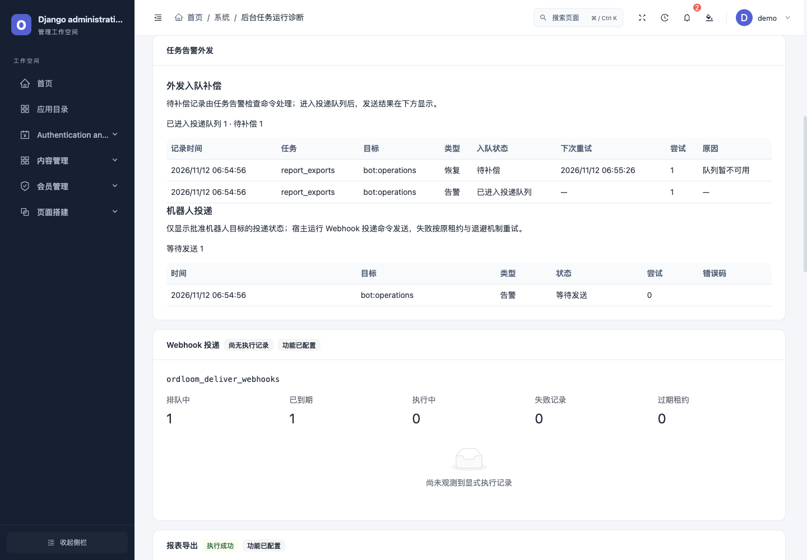

# 告警入队补偿与第三方运行、升级验收（1.1.0 起）

Ordloom 1.1.0 提供 P1-1、P1-2：持久告警入队补偿与第三方运行/升级契约。四个业务子包以 0.1.0 独立安装，最低要求核心 1.1.0。升级需要运行 `python manage.py migrate` 和 `python manage.py collectstatic --noinput`；新增 `0030_task_alert_admission` 保存告警外发意图，原 Webhook 队列与 API 继续使用原协议。迁移不会凭当前状态重建升级前未保存的历史外发事件。

## 告警入队补偿

告警状态变化时，站内消息、状态和每个机器人目标的外发意图在同一事务中保存。意图保存失败时回滚该次状态变化，后续观测可以重试。外发入队另用保存点，入队失败保留站内消息和意图；即使任务已经恢复、以后没有新的状态变化，后续调度也会补偿。持久记录仅含事件标识、任务/状态、原负责人主键、机器人引用、不可逆配置指纹和重试元数据，不含地址、凭据、业务值或异常正文。

仍需开启任务诊断、告警和站内通知，并按[外发配置](p2-operations.md)批准机器人及有效超级管理员负责人。沿用 default 数据库和宿主原子共享缓存；多实例必须使用同一缓存与数据库。新增可选策略：

```python
ORDLOOM_TASK_ALERTS = {
    "enabled": True,
    "external_owner": "1",  # 也支持 UUID 账号主键
    "external_targets": ["bot:operations"],
    "external_retry_seconds": 30,
    "external_max_attempts": 12,
    "external_max_age_seconds": 86400,
}
```

| 设置 | 默认值与范围 |
| --- | --- |
| `external_retry_seconds` | 30，范围 1–3600 秒；失败后指数退避，单次间隔最多 3600 秒 |
| `external_max_attempts` | 12，范围 1–100；每轮入队尝试上限 |
| `external_max_age_seconds` | 86400，范围 60–604800 秒；从意图创建时计算，手动重试不续期 |

```bash
# 预览：不写状态、不加租约、不入队、不发 HTTP
python manage.py ordloom_check_tasks --external-limit 100 --json
# 由宿主定时调度，同时评估告警并补偿到期意图
python manage.py ordloom_check_tasks --apply --external-limit 100 --json
# 修复故障后，显式重试预算耗尽且未过期、仍获授权的失败意图
python manage.py ordloom_check_tasks --apply --retry-external --external-limit 100 --json
# 已入队事件的网络投递和重试仍由原命令负责
python manage.py ordloom_deliver_webhooks --apply --json
```

`external-limit` 限制每次补偿选取数，范围 1–1000，默认 100；不改变原告警评估的范围。重试失败返回 `external_errors` 并以非零状态退出，已保存意图不会丢失。`--retry-external` 在不带 `--apply` 时仍只预览。后台仅显示诊断，不新增任务执行按钮。

共享缓存短租约、数据库行锁、事件/目标唯一约束共同防止重复入队。缓存或数据库不可用时停止当次处理，保留可再次读取的意图；不绕过租约执行。同一任务、负责人、目标配置与端点代次下，较后的恢复等待更早的待入队故障；一个目标故障不阻塞其他目标。这里保证入队顺序，外部平台最终接收仍受原投递重试和网络影响。

每次补偿重新检查当前模块、负责人有效/超级管理员状态、批准目标、原凭据指纹和端点代次；关闭告警、移除目标、更换负责人、轮换凭据或撤权会取消旧意图。已取消事件不会被手动重试恢复，也不会套用新凭据追发。已在网络传输中的请求不能撤回。过期或尝试耗尽分别记录固定原因；显式重试只重置本轮尝试次数，保留总次数、事件 ID、原目标和原截止时间。

超级管理员的「后台任务运行诊断」区分两层：

| 记录 | 状态 |
| --- | --- |
| 外发入队补偿 | `pending` 待入队、`retry` 等待重试、`admitted` 已进入投递队列、`canceled` 已取消、`failed` 失败待处理 |
| 机器人投递 | 原队列状态，成功与否由投递命令记录；入队成功不表示机器人已收到 |

原 `GET /api/task-diagnostics/` 继续要求当前有效超级管理员，`alert_deliveries.admission` 是新增可选字段。仅返回状态计数和最近 10 条安全元数据；旧字段保留，普通 staff 与匿名请求仍拒绝。意图截止时间不等于历史记录删除时间，本批没有自动删除终态意图。

隔离工程中的恢复入队失败示例（未向外部机器人发送）：



390px 界面将表格限制在可横向滚动的容器中，见[手机布局](../assets/p1-admission-mobile.png)。

## 第三方前端运行契约

`ordloom_check_apps` 仍是无业务数据库访问的**声明检查**，不会执行 JavaScript。仓库工具 `scripts/test_subapplication.py` 在独立虚拟环境中安装实际 wheel/sdist，必须逐应用运行非全跳过的 Python 测试，再加载包内分发 ESM。开发环境需要 `build`、Django、`uv`、受支持的 Python，以及 Node 和 `npm ci --prefix frontend` 的开发依赖。

```bash
python scripts/test_subapplication.py \
  --package /path/to/ordloom-news \
  --app-config ordloom_news.apps.ExtensionConfig \
  --peer examples/ordloom-demo --peer-config ordloom_demo.apps.ExtensionConfig \
  --output /tmp/news-current-contract.json
```

前端检查校验实际文件哈希、ESM 语法、单文件依赖、`activate(sdk)` 导出与结果、每个已声明页面/组件的函数注册；使用宿主相同的 React、Ant Design 有限 UI 和 `{data}` / `{props}` 形状实际渲染、卸载。页面数据来自通过授权断言的真实页面 API 响应，组件使用声明默认配置。渲染异常、缺失注册、未声明的 fetch/XHR 请求等会失败。SDK v1 暂无额外依赖/分块入口协议，第三方需将依赖打包进入单个 ESM。

报告分别列出声明、Python 实际运行/跳过数量、逐应用覆盖、前端和数据升级结果。指定 `--test-label` 不能遗漏组合应用的测试。`SubApplicationContractMixin` 自动记录成功的 GET 断言；应用专项可用下列装饰器，在断言成功后记录覆盖：

```python
from ordloom.testing import application_contract

@application_contract("news", "object_scope", "permission_revocation", "writes")
def test_scoped_write_and_current_permission(self):
    # 在这里实际断言本人写入成功、他人数据拒绝、撤权后拒绝。
    ...
```

分类为 `staff_read`、`asset`、`forbidden`、`anonymous`、`public_scope`、`object_scope`、`permission_revocation`、`writes`、`tasks`、`task_idempotency`。未报告的类别明确为 `not_reported`；没有页面的应用不会被描述为完成页面读取覆盖。装饰器是可信测试的声明，不自动证明断言质量。生成应用和示例现在各有 7 项测试，包含对象范围、撤权、实际保存接口、任务租约、重复执行与拒绝。

## 保留旧数据的真实升级

仅使用 `--baseline` 仍只做声明比较，报告 `data_upgrade.status=not_requested`。需要验证真实升级时，提供旧包源码；工具分别构建并隔离安装旧/新核心与组合应用，在旧包进程创建数据，用新包进程迁移**同一份工具专有 SQLite 数据库**，然后验证保留记录、已保存画布组件配置、负责人、账号权限和用户组。

```bash
python scripts/test_subapplication.py \
  --package /path/to/news-new --previous-package /path/to/news-old \
  --app-config ordloom_news.apps.ExtensionConfig \
  --peer examples/ordloom-demo --previous-peer examples/ordloom-demo \
  --peer-config ordloom_demo.apps.ExtensionConfig \
  --output /tmp/news-data-upgrade.json
```

主应用版本必须递增；每个 peer 提供对应 `--previous-peer`，未变化的包可使用相同目录。默认旧宿主与新宿主使用当前核心；可用 `--previous-core <旧核心源码>` 验证核心同步升级，旧核心须支持此测试协议。输出路径必须是新文件。失败退出非零，构建/安装/契约阶段的失败报告标记 `passed=false`，不会给失败候选签发通过报告。

应用通过 AppConfig 固定属性注册测试 fixture：

```python
ordloom_upgrade_fixture = "ordloom_news.contract_fixture.fixture"
```

fixture 继承 `ordloom.testing.UpgradeFixture`，`seed(context)` 返回可 JSON 序列化的合成业务标识与预期值；`verify(context, state)` 用 `context.check("records", fn)` 和 `context.check("object_scope", fn)` 完成必要断言，按业务再检查 `writes`、`tasks`、`task_idempotency`。上下文提供 `users`、`client(role)`、`page(role,id)`、`url(name, **kwargs)` 以及 unittest 断言；默认角色是 owner、other、root、denied。只有明确写入 fixture 的任务才会执行，通用检查不会自动调用所有业务任务。

旧包无法内置 fixture 时可提供受信任的 `--upgrade-fixture /path/to/sidecar.py`，导出以应用模块名为键的 `fixtures` 字典；同一协议用于旧/新进程，报告记录文件哈希。fixture 的 `settings` 只允许测试用 `ORDLOOM_*` 配置。不会接受既有工程设置模块、生产数据库路径或远程数据库连接。

自定义用户用 `--context-app <测试应用AppConfig> --user-model <app.Model>`，额外必填字段由 fixture 的 `create_user(role, app_id)` 提供。`--namespace private_admin` 使用真实后台命名空间；Mixin 默认读取工具命名空间，应用测试应通过 `sdk_url()` / `context.url()` 生成路径。默认账号与 Email/UUID 账号均有实际升级样例，不能据此认定所有组织/租户接入都已验证。

仓库自身的正反例门禁：

```bash
python scripts/test_subapplication_contracts.py --negative --output /tmp/sdk-upgrade-contracts.json
```

该工具生成 0.1.0 → 0.2.0 应用，真实增加一条迁移和字段，并验证旧记录获得预期默认值；与未升级的独立示例组合。覆盖默认用户及 Email/UUID 用户/后台命名空间、wheel/sdist；错误 ESM、删除旧记录的迁移和漏测 peer 必须失败。可通过 `--python`、`--django 4.2|5.2|6.0` 选择兼容环境。

这里执行的是可信构建和测试代码，属于本地开发验收；React 渲染使用 jsdom，并非真实浏览器、真机、WebGL 或外部平台认证。报告不含业务响应正文或凭据，也不等同代码沙箱、安全审计或发行方背书；目标浏览器和实际业务仍需独立验收。
