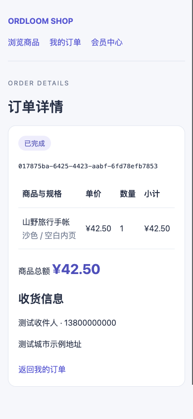

# 商城子应用 MVP

第三阶段提供独立 `ordloom-shop` 包，Python 模块为 `ordloom_shop`，基于子应用 SDK，并显式依赖 `ordloom-members`。发行包版本为 0.1.0，要求 Ordloom 1.1.0+；安装会自动解析核心与会员依赖。

## 安装与开放入口

从仓库根目录安装到宿主虚拟环境：

```bash
python -m pip install ordloom-shop==0.1.0
```

保留原 Django/Ordloom 配置，按需添加：

```python
INSTALLED_APPS += [
    "ordloom_members.apps.ExtensionConfig",
    "ordloom_shop.apps.ExtensionConfig",
]

ORDLOOM_SHOP = {
    "public_enabled": False,
    "checkout_enabled": False,
    "pending_seconds": 1800,
    "per_minute": 20,
}
```

```python
from django.urls import include, path

urlpatterns += [
    path("members/", include("ordloom_members.urls")),
    path("shop/", include("ordloom_shop.urls")),
]
```

```bash
python manage.py migrate
python manage.py collectstatic --noinput
python manage.py check
```

商城新增自己的 `0001_initial`，依赖会员初始迁移及宿主 User；本批不新增 Ordloom 核心迁移、不替换 User。源码现有核心迁移仍需正常执行。CMS 可选装，商城和会员可在未安装 CMS 的宿主中运行。

公开目录和下单分别默认关闭。先建立商品、SKU 和库存，确认权限与维护调度，再显式设置两个开关为 `True`；关闭目录或下单后，已登录会员仍可查询自己的历史订单。`ORDLOOM_DISABLED_APPS` 加入 `shop` 会同时关闭其管理模块、SDK 和公开入口；停用 `members` 时商城也自动停用，不影响其他 SDK 应用目录。停用不删除交易数据。

## 商品、SKU 与库存

后台「商城管理」注册商品、SKU、订单、订单明细、库存流水、订单记录和 SDK 商城概览。商品包含名称、标识、文本介绍、图片、上架状态；SKU 包含唯一编码、规格名称、单价、可售开关与只读库存。

1. 创建未上架商品和 SKU，填写单价（元）与规格。价格为 CNY，允许 0.01–9999999.99 元，最多两位小数。
2. 在「商城概览」输入 SKU 的库存变动数量与原因，点击「调整库存」。首次入库也走相同流程，初始库存为零。
3. 调整后刷新概览；库存流水记录操作者、原因、正负变动及调整后余额。已有流水的 SKU 不能换绑商品。
4. 将 SKU 设为可售，并由具有上架权限的人员将商品上架。公开目录只展示已上架商品；禁售 SKU 不公开。

普通目录保存不能直接改库存。SKU 保存会锁定并保留数据库的当前库存，避免旧编辑表单覆盖并发扣减。库存调整、下单和归还都在数据库事务中执行，使用行锁及带余额条件的更新；库存范围 0–1000000000。缓存不保存权威库存。人工调整必须有非零整数、原因及 UUID 请求编号，相同编号与相同内容重试不会重复入库；换内容重用编号返回 409。

公开 API 只返回规格是否有货，不返回实际库存数量。商品图片使用宿主原有上传和媒体存储；未上传图片时门户提供默认版式。商品介绍按文本转义展示，不接受可执行 HTML。

## 会员订单与状态

门户 `/shop/` 提供商品搜索、分页、规格选择、单品直接购买、收货资料、自己的订单列表与详情。JSON 下单额外支持一次购买最多 20 个不同 SKU，每个 SKU 数量 1–100；重复 SKU 应在调用端合并。

会员身份复用 `ordloom_members` 的当前有效会话。后台 staff 登录不会自动获得会员身份；会员停用、User 停用、改密导致旧会话失效或晋升 staff 后，旧会员会话不能继续访问订单。会员只能读自己的订单；用他人的 UUID 请求详情或流转仍返回 404，不借用创建者或后台的管理权限。

下单由服务器重读商品、规格、上下架及价格，拒绝客户端提供总额、状态、会员标识或额外价格字段。订单保存商品名、规格、编码、单价与数量快照，金额使用整数分计算并存储；API 的金额与整数分使用字符串传输，避免 JavaScript 浮点转换。后续商品改名、改价和下架不改写历史订单。

| 状态流转 | 操作者 | 库存行为 |
| --- | --- | --- |
| 创建 → 待确认 | 当前会员 | 原子扣减全部 SKU；任一不足则整单回滚 |
| 待确认 → 已确认 | 后台订单处理人员 | 保留扣减；超过截止时间不能再确认 |
| 已确认 → 已发货 | 后台订单处理人员 | 不再扣减 |
| 已发货 → 已完成 | 会员确认收货或后台处理人员 | 不再扣减 |
| 待确认 → 已取消 | 当前会员、后台或超时维护任务 | 原子归还一次 |
| 已确认 → 已取消 | 后台处理人员 | 原子归还一次 |

已发货及已完成订单不能直接取消。重复到达同一目标状态不会再次扣减或归还；非法跨状态操作返回 409。订单、明细、流水与事件不提供通用编辑/删除入口，状态只能通过服务流转。库存历史存在保护关联；有订单的会员不能通过级联删除交易历史，应采用停用账号流程。宿主可信维护代码和原始 SQL 仍须遵守这些不变量。

本版的待确认、已确认与发货状态不代表支付结果。没有在线收款、支付回调、退款、运费/税费计算或物流平台集成，金额为商品总额；运营确认及履约流程由宿主业务约定。

隔离验收示例：手机端已完成订单，使用合成商品与会员资料。



## 权限复用

管理复用当前 Django 模型权限、ModelAdmin 模块/对象检查及 `get_queryset(request)`；默认是一个商城管理范围，不自动以商品创建人隔离，也不宣称多商户或多租户结算。宿主已有组织范围可在相应 Admin 上继续扩展；服务使用原请求保留权限上下文。

| 操作 | 要求 |
| --- | --- |
| 管理商品和 SKU | 原 `view/add/change/delete` 权限与当前 Admin 范围 |
| 上架或下架商品 | 商品修改权限及 `ordloom_shop.publish_product`；其他编辑不能通过提交字段绕过 |
| 人工库存调整 | `change_sku`、`adjust_stock` 与当前 SKU 对象范围；SDK 概览还需 `view_sku` |
| 查询订单 | `view_order` 与当前订单范围 |
| 确认、发货、完成、关闭及超时任务 | `view_order` + `change_order`，每次重新检查对象范围；订单普通保存仍禁止 |
| 读取订单明细/事件 | 对应模型查看权限，并继承订单 Admin 的范围与对象查看规则 |
| 读取库存流水 | `view_stockmovement`，并继承 SKU Admin 的范围与对象查看规则 |

涉及组织隔离时，需要同时配置商品、SKU、订单及相关 Admin，而不是只隐藏菜单。公开商品是显式上架后的公共内容，客户订单读取按当前会员绑定，不执行后台通用字段查询。订单收货资料由宿主负责访问审计、存储保护与保留政策。

## JSON 接口与幂等

以下示例采用 `/shop/` 挂载；路径可由宿主修改。管理和会员写入都使用宿主 Session + CSRF，同源 Cookie 与 `X-CSRFToken` 必须携带。先通过 `/members/api/v1/session/` 获取会员 CSRF token；后台库存接口 GET 也能返回当前 token。

| 路由 | 用途 |
| --- | --- |
| `GET /shop/api/v1/products/` | 公开列表；`q` 名称搜索、`page` 分页 |
| `GET /shop/api/v1/products/<slug>/` | 已上架商品及可售 SKU、价格与有货标记 |
| `POST /shop/api/v1/orders/` | 当前会员创建订单，首次 201，相同请求重放 200 |
| `GET /shop/api/v1/orders/` | 当前会员订单摘要列表 |
| `GET /shop/api/v1/orders/<uuid>/` | 当前会员订单详情与购买快照 |
| `POST /shop/api/v1/orders/<uuid>/cancel/` | 会员取消自己的待确认订单，JSON `{}` |
| `POST /shop/api/v1/orders/<uuid>/complete/` | 会员确认自己的已发货订单，JSON `{}` |
| `GET/POST /shop/manage/api/stock/` | 后台权限下的 CSRF 获取/库存调整 |

```json
{
  "request_key": "1b5aa477-c264-45ed-a43a-e4642da85f21",
  "items": [{"sku": "b0d80e79-d908-4834-bd76-047a8442e02f", "quantity": 2}],
  "recipient": {"name": "测试会员", "phone": "13800000000", "address": "示例收货地址"},
  "note": "选定规格后提交"
}
```

`sku` 是商品详情返回的公开 UUID，不是后台自增 ID。每个新下单意图生成新的 `request_key`；网络重试必须保留原编号和内容。幂等范围为当前会员，同一请求内容在商品变价、下架或库存变化后仍返回原订单；同编号换内容拒绝 409。相同内容换新编号会创建新单。HTML 表单内置请求编号。

后台调整请求使用 **SKU 的后台整数 ID**：

```json
{"sku": 1, "delta": 10, "reason": "采购入库", "request_key": "d5bed09d-5fcb-4ea8-a89d-f327d33c7918"}
```

JSON 请求体最多 16 KiB；每页 20 条、页码 1–10000、商品搜索词最多 100 字、单个商品详情最多 100 个可售规格。收件人最多 100 字、电话 30 字、地址/备注各 500 字；单笔商品总额最多 1000000000000 分。电话是收货联系资料，不是已验证身份。

下单、会员流转和库存调整分别复用原共享 cache 的固定 60 秒来源/账号额度，默认每窗口 20 次，范围 1–120；429 带 `Retry-After: 60`。缓存不可用时写入拒绝 503，API 可按 `Retry-After` 重试；余额不足、状态或幂等冲突为 409。代理地址取 `REMOTE_ADDR`，多实例应配置可信代理和共享 Redis；频控不是库存锁。SQLite 并发写锁冲突会返回可重试错误，生产并发订单建议使用已验收的 PostgreSQL 路径。

## 超时维护与 SDK 搭建

`pending_seconds` 可设 300–604800 秒；默认待确认 30 分钟。只在创建时冻结截止时间，后续配置不改写旧单。**宿主必须调度维护任务**，任务未运行时不会仅因浏览器计时自动释放库存：

```bash
python manage.py ordloom_run_app_task ext:shop.expire --user 1
python manage.py ordloom_run_app_task ext:shop.expire --user 1 --apply
```

默认命令仅预览，`--apply` 每次最多处理当前账号范围内 100 条超时待确认订单，逐单事务，支持重复执行。已确认/已发货订单不因原待确认截止时间到期而关闭。每单重新读取执行账号并重建宿主任务授权上下文；中途撤权会停止后续处理，已完成的单据不回滚，重试跳过已关闭记录。沿用 SDK 共享缓存短租约与任务诊断。调度周期由宿主 cron/任务平台决定，SDK 不内置调度器。

H5/大屏组件库「子应用 → 商城入口」支持标题、说明和站内路径，默认 `/shop/`，保存与公开展示沿用 SDK。组件是静态入口，不自动开放会员订单或任意 API 数据绑定。商城概览沿用 SDK 1000 对象检查和响应预算，超过范围应使用后台分页列表与专门的宿主分页适配，不是无上限库存工作台。

## 验证与后续范围

```bash
python scripts/test_products.py --shop
python scripts/test_products.py --shop --email-user
python scripts/test_ownership_postgres.py --shop
python scripts/test_products_install.py --shop --output /tmp/shop-install-new.json
python scripts/dev_products.py --shop
```

测试仅使用自建临时数据库；PostgreSQL 脚本使用独占临时容器，不接受外部数据库 URL。覆盖不同会员争抢最后一件、并发同请求重试、并发取消只归还一次、快照/精确金额、当前权限与 Admin 范围、任务中途撤权、停用、CSRF、频控故障，以及 CMS/会员组合兼容。另验证 Python 3.9/Django 4.2、Django 5.2 和商城 Django 6.0 专项；约束定义兼容新旧构造参数。原生浏览器验收使用临时宿主。

下一步候选是支付与回调幂等、退款和履约补偿、购物车、优惠及运费、物流跟踪，以及微信业务渠道扩展。当前没有在线支付、支付凭据、自动扣款、多仓库存、采购/入库单、多商户分账、地址簿或游客下单；云函数仍仅调研。

可选 [微信接入 MVP](wechat.md) 已实现公众号/小程序会员绑定、登录和回调验签，微信来源会话撤销会通过现有会员层限制后续商城访问；支付回调仍未实现。
