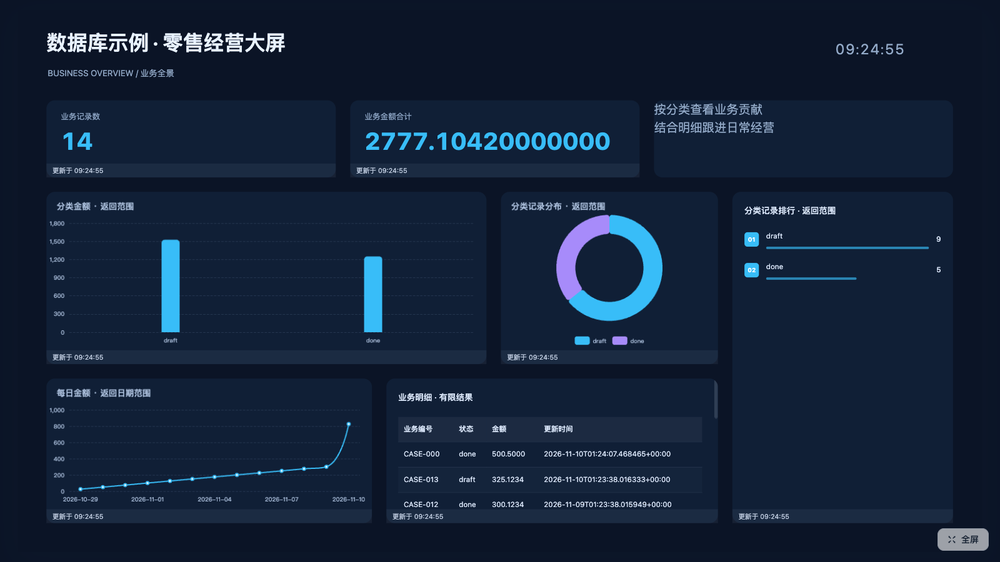
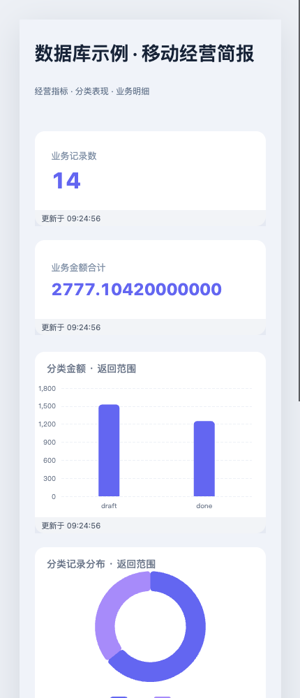
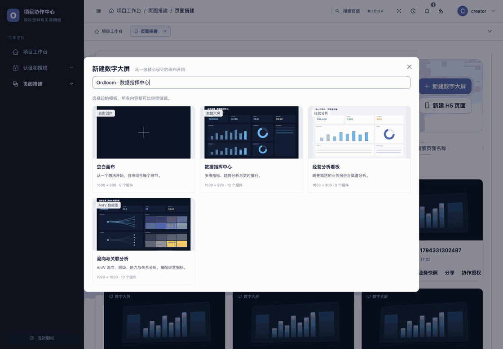

# 大屏、H5 与多屏轮播

从「页面搭建」创建数字大屏或 H5，选择空白画布、静态模板或业务数据模板，然后拖入组件、调整属性并保存。

## 画布与组件

数字大屏默认 1600×900，H5 默认宽 375；画布尺寸可在允许范围内调整。大屏按视口等比缩放，H5 按宽度适配并纵向滚动。

组件库提供 39 种搭建选项、22 类组件，包括文本、图片、指标、图表、表格、排行、表单和媒体等。
图表包括 11 类 ECharts 与 7 类 AntV。11 套静态模板用于页面起始布局，6 套业务模板用于生成经过授权查询的数据集和绑定。
业务模板新增库存概览、项目工时和线索跟进简报，模板字段支持显式 JSON 标量、单值关联和时长。使用及边界见 [行业模板指南](conditional-pages-and-antv-reports.md)。

模板中的样例值用于演示；标题包含「实时」不代表已配置自动刷新。

编辑器支持拖入、移动、缩放、对齐、图层、隐藏、复制、撤销重做、JSON 导入导出、图片素材、预览和全屏。
一页最多 200 个组件；名称、尺寸、组件属性及 JSON 均由服务端再次校验。输入框保留原生文本撤销和方向键行为。

保存只写页面布局与引用，不把实时查询结果写入页面、撤销记录或 JSON 导出。
预览用于检查布局和交互，公开分享展示最近保存的内容。

## H5 滚动动画

在组件属性中选择载入、进入视口或跟随滚动的动画触发方式，设置范围、位移、缩放、视差或逐行文字效果。
使用长画布预览滚动距离和正反方向表现；手机屏幕、浏览器减少动态效果偏好及后台节流会影响最终体验。

## 绑定业务数据

先由宿主开放模型字段，再在 [数据集工作室](../data/datasets.md) 保存查询并发布版本。
在组件的数据配置中选择数据集、明确版本、参数及字段角色，预览后保存页面。
图表类目/数值、指标、表格和排行等使用各自的映射要求，字段能力或当前权限不匹配时会拒绝保存或读取。

组件独立选择手动、定时、通知或组合刷新。隐藏、切走和更换绑定会取消请求，迟到响应不覆盖新内容。
网络错误可保留并标记过期结果；权限撤销或结构变化会清除结果。[刷新与事件指南](../data/events-and-services.md) 说明部署方式。

## 多屏轮播

在轮播管理中选择可管理的大屏，设置顺序及每屏 5–3600 秒的停留时间，再保存。
支持循环或播完停止、暂停、手动切屏、全屏、预取和失效页面跳过。
每次进入一屏按当前访问者权限读取数据；后台轮播和组件刷新分别维护状态。

普通 staff 默认管理自己创建的个人页面和轮播，超级管理员可管理全部；启用 [工作区](collaboration.md) 后按角色与逐资源授权计算。
公开轮播具有独立入口、密码与有效期；子页面链接令牌轮换后，需要重新保存轮播确认引用。

## 分享与离线

[公开分享](sharing.md) 控制 UUID 入口、密码、有效期和独立链接令牌。公开页面中的业务数据需要单独按页授权，UUID 本身不授予模型数据权限。
二维码地址必须可被目标手机访问。

需要断网编辑或保存业务副本时，按 [离线指南](offline.md) 明确准备程序、画布或只读快照。

