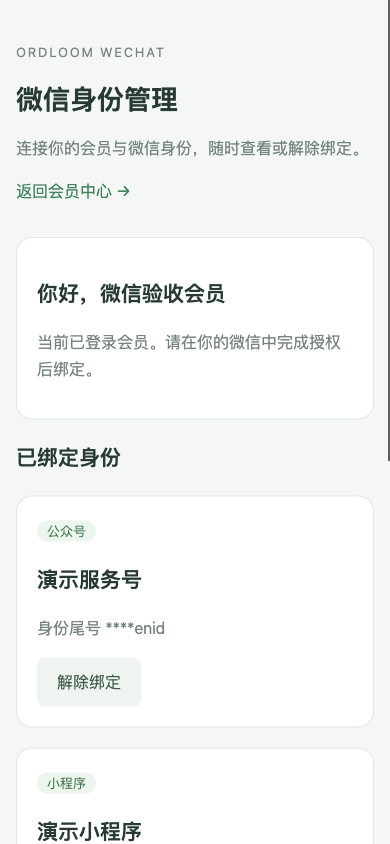

# 微信公众号与小程序接入 MVP

`ordloom-wechat` 是生态第四阶段独立子应用，Python 模块为 `ordloom_wechat`，依赖子应用 SDK 和 `ordloom-members`。包含渠道管理、消息回调验签/AES 解密、收件去重、公众号网页授权、小程序 code2Session、显式会员绑定与解绑、已绑定会员登录、SDK 概览/入口组件及留存维护任务。

发行包版本为 0.1.0，依赖 Ordloom 1.1.0+ 和 ordloom-members；不包含公众号平台账号申请或小程序前端工程。

## 安装与默认开关

```bash
python -m pip install ordloom-wechat==0.1.0
```

保留宿主原来的认证、Session、CSRF 与模板配置，增加：

```python
INSTALLED_APPS += [
    "ordloom_members.apps.ExtensionConfig",
    "ordloom_wechat.apps.ExtensionConfig",
]
```

```python
from django.urls import include, path

urlpatterns += [
    path("members/", include("ordloom_members.urls")),
    path("wechat/", include("ordloom_wechat.urls")),
]
```

```bash
python manage.py migrate
python manage.py collectstatic --noinput
python manage.py check
```

微信应用有自己的 `0001_initial`，依赖会员与宿主 User；无新增核心迁移、无会员表结构变更，不替换 User。可以仅安装核心+会员+微信，也可与 CMS/商城组合。数据和交易使用同一 default 数据库。

## 服务端凭据配置

模块默认关闭；数据库渠道的启用、回调、新绑定与登录开关也默认关闭。凭据放在宿主设置或密钥管理器，通过引用关联渠道；AppSecret、Token 和 AES Key 不写入应用模型，不回传后台或会员前端。

```python
import os

ORDLOOM_WECHAT = {
    "enabled": True,
    "public_origin": "https://app.example.com",
    "per_minute": 20,
    "callback_per_minute": 600,
    "timestamp_skew": 300,
    "receipt_days": 7,
    "credentials": {
        "service_main": {
            "appid": os.environ["WECHAT_SERVICE_APPID"],
            "app_secret": os.environ["WECHAT_SERVICE_SECRET"],
            "token": os.environ["WECHAT_SERVICE_CALLBACK_TOKEN"],
            "aes_key": os.environ["WECHAT_SERVICE_AES_KEY"],
        },
        "mini_main": {
            "appid": os.environ["WECHAT_MINI_APPID"],
            "app_secret": os.environ["WECHAT_MINI_SECRET"],
            "token": os.environ["WECHAT_MINI_CALLBACK_TOKEN"],
            "aes_key": os.environ["WECHAT_MINI_AES_KEY"],
        },
    },
}
```

`public_origin` 只允许源站，不含用户名、路径、查询和片段；生产要求 HTTPS。只有宿主 `DEBUG=True` 的 localhost/loopback 开发验收允许 HTTP。OAuth 回跳地址由该可信源站与应用命名路由拼接，不接受客户端指定跳转域名或 `next`。

后台「微信接入 → 微信渠道」填写类型、AppID、微信原始 ID、服务端凭据引用，例如 `service_main`，逐项开启需要的功能。AppID 必须和引用凭据中的 AppID 一致；保存后的 AppID 和类型固定，换应用应创建新渠道。微信原始 ID 用于校验消息的 `ToUserName`。开启回调需要 Token；默认 AES 模式还需要合法的 43 字符 EncodingAESKey。

没有消息接收需求时可以关闭回调，不必提供其 Token/AES Key；身份接入需要 AppSecret。后台只能引用凭据，不能创建或读取密钥内容。服务器只向固定 `https://api.weixin.qq.com` 身份端点请求，拒绝跳转，3 秒超时、32 KiB 响应上限；不接受动态上游 URL。

## 公众号与小程序流程

**公众号网页授权**：已登录会员在 `/wechat/` 点击授权绑定，后端创建 5 分钟、单次使用的 state，绑定浏览器会话、当前会员/密码哈希和渠道配置，再生成微信授权地址。授权 scope 为 `snsapi_base`，仅获取身份，不拉取昵称、头像或手机号；回调验证 state 后由服务端交换 code。已绑定身份可在未登录会员时发起微信登录。

网页授权需要账号自身拥有微信网页授权能力，普通订阅号不能据此获得服务号权限。应在微信平台配置与 `public_origin` 一致的网页授权域名，并按官方规则配置服务器域名/IP 白名单等。缺少平台权限不能通过本模块绕过。[微信网页授权官方指南](https://developers.weixin.qq.com/doc/service/guide/h5/auth.html)。

**小程序**：客户端调用 `wx.login` 获取新 code，再 POST 至服务端交换端点，明确 `intent: "bind"` 或 `"login"`。绑定前需已有有效会员会话；登录只允许已经绑定且仍有效的会员。服务端调用 code2Session，立即丢弃上游 `session_key`，不把它作为会员令牌，也不回传客户端。[小程序登录凭证校验官方文档](https://developers.weixin.qq.com/miniprogram/dev/server/API/user-login/api_code2session.html)。

两种流程都不接受客户端提交 OpenID、UnionID、会员 ID 或权限标识。身份唯一键为渠道+OpenID；同一渠道中一个会员只绑定一个微信身份。冲突拒绝，不自动抢绑，不凭相同 UnionID、邮箱或手机号合并会员。没有绑定的微信身份不会自动创建 User 或会员；新用户可先使用宿主已开放的会员注册流程，再显式绑定。

服务器保存 code 的 HMAC 防重标记，不保存原始 code。一次请求失败或上游网络结果不确定时，需要重新获取 code；重复 code 拒绝 409。OAuth state 也只能消费一次，换浏览器/会员、密码变化、到期、渠道或凭据变化后拒绝。

## 会员会话及解绑

微信登录建立原 `ordloom_members` 会话，沿用其有效期、密码哈希、会员启用及 User 活跃/非 staff 检查。它与 Django 后台认证共用宿主 Session，但不替换后台身份。公众号跨站顶层 GET 回跳需允许携带原会话 Cookie（通常使用 SameSite=Lax），以保持 state 所属浏览器一致。

本批为会员增加可选的可信会话来源校验接口 `register_session_provider`。普通密码会话不携带来源，行为不变；微信来源会话还校验当前绑定、版本、渠道登录开关与模块状态。会员解绑、后台撤销、渠道/模块停用后，旧微信来源会话下次访问时失效，包括 CMS、商城及原会员接口；重新绑定不会复活旧会话。普通密码会话不因解除微信绑定而退出。

会员只能查看、解绑自己的记录，页面仅显示身份尾号；后台可按权限撤销绑定并保留历史。后台 staff 会话本身不能代替会员完成绑定。关闭「允许新绑定」不自动解除旧绑定；关闭登录、渠道或模块会使微信来源会话失效。轮换凭据会使待完成授权失效，不自动修改已绑定会员归属。

若未来卸载微信应用，带有未知来源的旧会员会话会拒绝使用。会话来源校验只允许可信安装代码注册，不接受客户端指定验证函数。

隔离验收中的手机页面，使用模拟微信身份和合成会员资料：



## 消息回调与收件

平台服务器地址填写 SDK 概览给出的 `/wechat/callback/<渠道 UUID>/` 完整公开 URL。它与公众号 OAuth 回跳 `/wechat/official/<UUID>/callback/` 是不同端点，不要混用。

- GET 验证当前 Token、timestamp、nonce、signature，返回 `echostr` 纯文本。
- POST 支持 XML/JSON；AES 安全模式验证 `msg_signature`、解密 CBC/PKCS#7、检查接收 AppID 与原始 ID。明确配置明文模式时才接受明文，不自动降级。
- 默认时间偏差最多 300 秒（可配置 60–600）；消息最多 64 KiB，XML 禁用 DTD/实体/外部引用，JSON 拒绝重复键与超预算嵌套。
- 渠道+消息 ID 去重；没有 ID 的事件按内容摘要去重。相同 ID 换内容拒绝。数据库持久化成功后才返回 `success`，失败返回错误以便平台重试。

AES 验证包含官方公开密文样例及独立构造的回调测试。明文签名不覆盖消息体，本版明文回调只用于显式选择的收件兼容，不能用它完成会员绑定或登录。默认使用 AES 安全模式。[消息推送官方说明](https://developers.weixin.qq.com/doc/service/guide/dev/push/)、[加解密官方说明与功能样例](https://developers.weixin.qq.com/doc/service/guide/dev/push/encryption.html)。

收件保存消息类型、事件名、发送方标识、消息 ID、文本内容及摘要，不保存完整原始消息、密钥或媒体数据。它是收件与排障记录，不是完整业务队列；关注、授权撤回、支付等事件仅记录，不自动改变会员、订单或其他业务状态，不自动回复或外发消息。

## API 与小程序会话对接

以下为默认挂载，成功响应为 `{ "ok": true, "data": ... }`：

| 路由 | 用途 |
| --- | --- |
| `GET /wechat/api/v1/session/` | CSRF token、当前会员、公开渠道及自己的绑定 |
| `POST /wechat/api/v1/mini/<uuid>/exchange/` | JSON `code` + `intent`，交换身份并绑定或登录 |
| `POST /wechat/api/v1/official/<uuid>/authorize/` | JSON `intent`，返回 `authorize_url`；HTML 表单直接跳转 |
| `GET /wechat/official/<uuid>/callback/` | 微信 `code/state` 回跳，成功后跳回固定身份管理页 |
| `GET /wechat/api/v1/bindings/` | 自己的绑定，OpenID/UnionID 不作为响应身份凭据 |
| `POST /wechat/api/v1/bindings/<uuid>/unbind/` | JSON `{}`，解除自己的绑定 |
| `GET/POST /wechat/callback/<uuid>/` | 平台消息验签端点，不提供会员写入 |

所有会员 POST 继续使用 Cookie + `X-CSRFToken`，只有消息回调免 CSRF，且必须通过平台验签；OAuth GET 回跳通过绑定浏览器的单次 state 防护。JSON 身份请求最多 8 KiB，code 最多 512 字符；JSON 渠道/绑定列表最多 100 条。

小程序客户端应维护宿主 Cookie（处理 `Set-Cookie` 并在后续请求发送 `Cookie`），先 GET session 获取 CSRF token，再调用会员注册/密码登录或微信交换接口。不能把 `session_key`、OpenID 或 UnionID 当作后台会话。带有微信小程序平台 Referer 的 HTTPS 请求，需要宿主显式信任该来源，并保留 CSRF token 检查：

```python
# 按宿主既有可信来源配置追加，不覆盖其他来源。
CSRF_TRUSTED_ORIGINS += ["https://servicewechat.com"]
```

调用形态（`cookieHeader`、`csrfToken` 由宿主会话握手维护）：

```javascript
wx.login({
  success({ code }) {
    wx.request({
      url: apiOrigin + "/wechat/api/v1/mini/" + channelId + "/exchange/",
      method: "POST",
      header: { "Content-Type": "application/json", Cookie: cookieHeader, "X-CSRFToken": csrfToken },
      data: { code, intent: "bind" },
      success(response) {
        // 保存更新的宿主 Cookie；只消费会员结果，不保存微信上游密钥。
      }
    })
  }
})
```

生产配置微信 request 合法域名、HTTPS 与代理真实地址；访问日志对 OAuth `code/state` 及验签参数脱敏。测试客户端/公众号账号的权限不能代替真实发布账号权限，域名与平台能力需实际联调。

## 权限、缓存与维护

管理沿用 Django 模型/模块/对象权限和当前 `ModelAdmin.get_queryset`。渠道默认属于一个管理范围，不自动提供多商户隔离；宿主可继承 Admin 增加组织范围。绑定和收件继承渠道范围，绑定历史继承绑定范围。

| 操作 | 要求 |
| --- | --- |
| 查看渠道/概览 | `view_channel` 与当前渠道范围 |
| 创建渠道、修改配置/开关 | 原 add/change 权限 + `configure_channel`；无额外权限者只能改名 |
| 查看绑定/收件/历史 | 各自模型查看权限及父级 Admin 范围 |
| 后台撤销绑定 | 绑定查看权限 + `revoke_identitybinding`，逐对象复核 |
| 留存清理 | 渠道/收件查看权限 + `purge_callbackreceipt` 及当前范围 |

绑定、收件和历史没有通用修改/删除入口；AuthFlow/CodeUse 内部授权记录不注册到 Admin 或通用字段目录。凭据只在宿主设置中，后台页面与 SDK 组件不包含实际密钥。

复用原共享 cache 的 add/incr 原语频控：身份请求按来源计数，绑定/解绑增加会员额度，默认每动作 60 秒窗口 20 次（1–120）；回调按渠道来源默认 600 次（1–10000）。多实例使用共享 Redis，代理地址取 `REMOTE_ADDR`。缓存故障拒绝接入，429/503 带重试时间；真正的 code 防重、绑定唯一性和收件去重由数据库保证。

```bash
python manage.py ordloom_run_app_task ext:wechat.cleanup --user 1
python manage.py ordloom_run_app_task ext:wechat.cleanup --user 1 --apply
```

宿主调度此任务；默认仅预览。显式执行每次最多清理 1000 条过期 state、1000 条过期 code 标记和 1000 条过留存期收件，默认留存 7 天（1–90），沿用当前授权上下文、SDK 短租约与任务诊断，不删除绑定与绑定历史。维护不是业务消息消费或重放。

`ORDLOOM_DISABLED_APPS` 停用 `wechat` 或 `members` 时微信入口、SDK 目录及微信来源会话关闭，其他未依赖的子应用继续工作。H5/大屏的「微信会员入口」仅是可公开的静态站内链接，不自动读取会员资料，也不开放订单或其他数据绑定。

## 验证范围与后续

```bash
python scripts/test_products.py --wechat
python scripts/test_products.py --wechat --email-user
python scripts/test_ownership_postgres.py --wechat
python scripts/test_products_install.py --wechat --output /tmp/wechat-install-new.json
python scripts/dev_products.py --wechat
```

这些工具仅使用自建临时数据。浏览器宿主使用固定模拟微信上游，接受 `demo-*` 测试 code，不能用于生产；生产代码没有可配置的任意上游 URL 或模拟身份开关。验证包括官方 AES 样例、XML/JSON、回放去重、并发抢绑/收件、OAuth 会话边界、来源撤销、Cookie/CSRF、小程序 Referer、权限和组合安装。真实微信账号、外网回调、网页授权域名及小程序真机未以本地模拟验收代替。

MVP 不包含支付、公众号群发/客服发送、素材/菜单管理、订阅通知、用户资料解密、自动创建/合并会员、第三方代授权、完整小程序前端或消息业务队列。后续应按实际业务补授权撤回/注销处理、合规留存流程、通知与支付回调；云函数仍仅调研。
